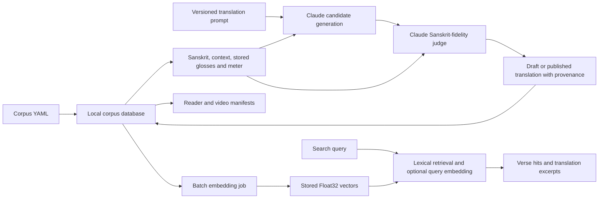

# AI systems and evaluation

This explanation and operating reference describes merged code at `origin/main` **`4c94bf2`**, inspected **2026-10-12**. It distinguishes the implemented generation/evaluation mechanism, provenance present in corpus files, and proposed improvements. Runtime credentials and a checked-in pipeline do not establish that a live deployment has semantic search enabled or that every existing translation was generated with the current runner.

## System boundary

The AI surface has three connected uses: Sanskrit-grounded translation with a model judge; embeddings for optional semantic retrieval; and speech synthesis in the [video platform](AI-VIDEO-AND-YOUTUBE-PLATFORM.md). Translation and embedding jobs run on a build/operator host. Reader pages display stored translations rather than generating interpretations per page request. Search can call an embedding API at request time when configured.



The model is not an autonomous agent framework. Retrieval returns verse hits; no implemented answer-generation step makes this a retrieval-augmented generation service. The application demonstrates evaluation and retrieval components without establishing large-scale ML training, Kubernetes orchestration, or a production vector-service deployment.

## Translation inputs, grounding and outputs

[runner.ts](../pipeline/translate/runner.ts) selects corpus units with **no translation row in the requested language**, ordered by chapter and unit number. A draft, reviewed, or published row all count as existing. A retry therefore fills missing results; it does not regenerate low-scoring drafts or automatically rescore published content.

For each unit the runner loads:

- Devanāgarī, IAST, SLP1, and the optional meter label.
- Stored `word_glosses` rows for the target language, falling back to English only when no target-language rows exist, including lemma and morphology strings.
- Up to two preceding Sanskrit units in the same text, including across a chapter boundary.
- A configured public-domain reference citation/note, if available.

[The translation prompt](../pipeline/translate/prompts/v1-sanskrit-grounded.md) asks for meaning grounded in Sanskrit, ambiguity disclosure, school-aware technical vocabulary, and a JSON candidate containing `translation`, `word_glosses`, `confidence`, `sanskrit_grounding_notes`, `deviations_from_pd_english`, and `technical_term_resolutions`.

The runner substitutes database strings into the prompt; it does not fetch a dictionary, DCS annotation, meter classifier, or Vidyut result during generation. The separate [morphology audit](../pipeline/morph/README.md) cross-checks pre-existing glosses but its output is not wired into this runner. Calling every stored morphology label “Vidyut-generated” or every gloss “verified Cologne MW” would overstate grounding.

The public-domain reference map currently supplies bibliographic citations and notes for Karpūrādi and Mahānirvāṇa. It does not inject their full English verse translations. The runner's Vijñāna Bhairava reference remains null and the older shorter `vijnana-bhairava` key differs from the corpus's `vijnana-bhairava-tantra`. Other unmapped works receive an explicit no-reference message. The prompt's reference policy is stronger than the amount of reference text currently supplied.

## Models and prompt provenance

The live runner calls `claude-sonnet-4-5-20250929`, including for its judge. It records `model_version` as that API model and a logical `model` label of `claude-sonnet-4-6`. Both are literal constants in the baseline; do not describe the display label as proof that the API used a newer model.

Generation uses temperature `0.2`; judging uses `0.0`; each request has `max_tokens=4096`. Prompt identifiers are `v1-sanskrit-grounded` and `v1-judge`. The runner writes the translation prompt identifier in `prompt_version` and mentions both in `source`. It does not store a judge-model field, full prompt content/hash, judge rationale, or concerns as separate durable records. It logs candidate confidence but does not persist the candidate's full explanatory payload or generated target-language glosses.

The source corpus records a different historical mix:

| Recorded `model` | Rows at 2026-10-12 |
|---|---:|
| `claude-opus-4-8` | 32,339 |
| `claude-opus-4-7` | 3,626 |
| absent/null | 311 |

These are YAML provenance labels, not a new assertion about provider model availability, reproducible API calls, or which runner created each row. [merge_indic.py](../pipeline/translate/merge_indic.py) carries model/version metadata from translation shards and can infer a legacy model label from `translator`; it does not judge the text. This separate merge route explains why current corpus content must be audited independently of the current runner's code.

## Judge rubric and status semantics

[The judge prompt](../pipeline/translate/prompts/v1-judge.md) scores Sanskrit fidelity on an integer 1–10 scale. It penalizes interpretations conflicting with morphology or lexicon, unjustified flattening of technical terms, copying modern copyrighted translations, and reproducing a public-domain English reference instead of working from Sanskrit. It rewards grammatical fidelity, explicit term choices, appropriate register, and honest ambiguity. Output is `{score, rationale, concerns}`.

The runner sets `ai_assisted=1` and `status='published'` when `score >= 7`; a lower score is `draft`. The database schema constrains the status enum and AI flag but does **not** enforce a 1–10 score range or the score-to-status relationship. The runner strips optional Markdown fences then uses `JSON.parse` and a TypeScript cast; it does not perform runtime Zod validation of candidate/judge output, completeness or integer bounds. A JSON-shaped response is not necessarily a validated evaluation record.

[STATUS-CONTRACT.md](../STATUS-CONTRACT.md) states the intended public distinction:

| State | Intended meaning | Public reads |
|---|---|---|
| AI + draft | Candidate awaiting acceptance | Excluded |
| AI + published | Judge-accepted candidate; human verification pending | Included |
| AI + reviewed | Human-accepted AI translation | Included |
| Human + published/reviewed | Non-AI translation with source attribution | Included |

[ai-badge-state.ts](../src/lib/ai-badge-state.ts) and [its tests](../tests/unit/ai-assisted-badge.test.ts) implement amber “AI · not verified” and emerald “AI · reviewed by …” badges. The badge helper defensively treats any non-reviewed AI state as unverified. It is not itself a filtering function: public read paths must exclude drafts. The non-AI badge currently treats the row as public domain; that simplified UI must not replace the row/source license as the authority for reuse rights.

Measured corpus reality differs from a fully enforced evaluation contract. All **36,276** rows are marked published, **36,019** are AI-assisted, only **2,689** have a judge score, and none have a reviewer. There are no reviewed or draft rows in the selected source snapshot. Absence of a score is not evidence of a failing score; it means the repository does not retain evidence of an individual judge result. A published state alone cannot substantiate the intended “passed judge ≥7” claim for those imported rows.

The contract's quarterly audit of 50 published rows per language, audit-log persistence, high-confidence badge, expanded review states and review tooling are proposals in that document. Their presence in prose does not establish a completed calibration study or a merged `audit_log` implementation.

## Orchestration, failure handling and operating examples

[dispatch.ts](../pipeline/translate/dispatch.ts) fans out the eleven Indic languages with a default concurrency of 3 and up to 3 attempts. Each language subprocess receives a pinned translator label. Transient errors such as 429, 5xx, timeouts and transport failures use exponential backoff starting at 5 seconds. Missing translations are queried again on retry, so committed successes are not translated twice. Both generation and judging have 1.5-second pacing sleeps; a centralized cross-provider rate-limit gateway remains planned.

The runner catches per-unit errors, retains failures in `RunSummary`, continues the remaining units, and exits 2 if any failed. Dispatch writes a JSONL completion record per language plus a final summary under `pipeline/translate/runs`; partial completed chunks leave evidence if interrupted. Dispatch exits nonzero for failed language chunks. Missing credentials or a missing client can produce `skipped` units without a failure exit, so inspect skipped counts as well as process status.

After a credentials-free database build, this dry run performs no model requests and inserts no translation rows:

```bash
bun pipeline/translate/runner.ts --text siva-sutras --lang hi --limit 1 --dry-run --json
```

The baseline already has complete Hindi coverage, so this correctly reports zero pending units. To exercise input construction without deleting accepted content, use a fixture in a new isolated database:

```bash
bun pipeline/ingest/init-db.ts --db /tmp/sohamhamso-ai-fixture.db
bun -e 'import {Database} from "bun:sqlite"; import {parseTextYaml,prepareStatements,ingestText} from "./pipeline/ingest/ingest"; const d=new Database("/tmp/sohamhamso-ai-fixture.db"); d.exec("PRAGMA foreign_keys=ON"); const p="tests/fixtures/sample-corpus.yaml"; ingestText(d,prepareStatements(d),parseTextYaml(p),p); d.close();'
bun pipeline/translate/runner.ts --text siva-sutras --lang ta --db /tmp/sohamhamso-ai-fixture.db --limit 1 --dry-run --json
```

The fixture's slug is `siva-sutras`; its existing English rows leave Tamil pending. Dispatch's `--dry-run` avoids API calls/translation writes but still creates a local JSONL manifest. A live run without `--dry-run` requires `ANTHROPIC_API_KEY`, incurs provider charges and writes translations; accepted results must be reconciled into source YAML before rebuilding the database. The Anthropic SDK is already a project dependency; `bun install` is sufficient.

Recovery depends on the failure point. Transport errors can be retried. A successfully inserted low-score draft needs an explicit review/regeneration decision because the missing-row selector will skip it. Malformed JSON errors need prompt/output inspection rather than blind transient retries. Preserve model and prompt identifiers when changing an accepted result. [The provenance decision](decisions/003-translation-provenance.md) records why those distinctions matter.

## Embeddings and retrieval

[embed/runner.ts](../pipeline/embed/runner.ts) embeds `translation_text + "\n\n" + iast` using `text-embedding-3-large` with 3,072 dimensions, batches up to 100 inputs, and stores Float32 BLOBs keyed by `(verse_id, lang, model)`. Existing vectors are skipped. The pending query currently has **no translation-status filter**; contrary to older docs it can select draft translations. Multiple translators can also produce several pending candidates for one vector key. Vectors are not tied to a translation-content hash, so editing a translation does not invalidate a previously embedded row.

The CLI uses the default local database path and accepts `--lang`, `--text`, `--limit`, `--dry-run`; there is no `--db` option. It checks `OPENAI_API_KEY` before even reaching the dry-run inventory path. A safe offline inventory therefore uses a deliberately non-secret placeholder:

```bash
OPENAI_API_KEY=offline-dry-run-placeholder bun pipeline/embed/runner.ts --text siva-sutras --lang en --limit 1 --dry-run
```

This opens/reads the local DB and prints an estimate without calling the provider. Its hardcoded $0.13 per million tokens and 50-token estimate are planning constants, not current provider pricing or measured spend. A live run requires a real key and incurs API costs.

[src/lib/search.ts](../src/lib/search.ts) implements three functions returning `VerseHit[]`:

| Function | Execution | Missing key / missing vectors |
|---|---|---|
| `lexicalSearch(q, lang, limit)` | FTS5 when `verses_fts` exists; parameterized LIKE otherwise; synonym expansion | Works without AI credentials |
| `semanticSearch(q, lang, limit)` | Embeds query; scans matching-language/model vectors; cosine scoring; hydrates metadata | Returns `[]` |
| `blendedSearch(q, lang, limit)` | Runs both legs; reciprocal rank fusion with `k=60` | Returns lexical hits when semantic leg is empty or throws |

The query vector cache is an **in-process LRU**, 1,000 entries with a 7-day TTL, keyed by trimmed lower-case query. Cloudflare KV caching, separate vectors DB and `vector_top_k()` appear in design comments, not in the implemented search path. Full scan is the current mechanism; no claimed sub-50-ms p95 or 100,000-row scale is established by a benchmark in this documentation.

The [search API](../src/pages/api/search.ts) is `GET /api/search?q=…&type=lexical|semantic|blended&limit=…&lang=…`. Query text is required, trimmed and at most 500 characters; limit clamps to 1–50 with default 8. Unknown `type` values fall back to lexical, and language is lower-cased rather than enum-validated. Success returns `{data, meta:{count,type,took_ms,note?}}` with a 30-second cache header; errors use `no-store`. The default API type is lexical. Explicit `type=semantic` does not itself fall back to lexical; use `blended` for that behavior. Excerpts filter to public statuses, but a previously created vector can still reflect draft/older content: retrieval eligibility and embedding eligibility are distinct controls.

## Evaluation evidence and known limits

[Dispatch tests](../tests/unit/translate-dispatch.test.ts) cover orchestration/retry contracts; [merge tests](../tests/unit/translate-merge-indic.test.ts) cover shard completeness and metadata; [search tests](../tests/unit/search.test.ts), [search regression](../tests/unit/search.regression-1.test.ts) and [edge regression](../tests/unit/search-edge-compat.regression-1.test.ts) cover retrieval and runtime boundaries. [Morphology comparison tests](../tests/unit/morph-compare.test.ts) exercise deterministic fixture logic. These tests establish code behavior without measuring translation quality or live provider performance.

The judge uses the same configured model as generation. Shared model biases, wrong source morphology, polysemous Sanskrit terms and cultural/school context can produce mutually consistent errors. A score threshold is a release heuristic, not an accuracy percentage. A proper empirical assessment would retain prompt/output lineage, measure expert agreement and error classes per language, and calibrate on held-out samples; that work remains an opportunity, not a reported accomplishment. No cost, latency, hallucination-rate or human-approval uplift is asserted without measurements.

Related: [corpus reference](CORPUS-AND-DATA-PLATFORM.md), [operations](OPERATIONS-AND-QUALITY.md), [security and provenance](SECURITY-PROVENANCE-AND-LICENSES.md), and [translation status contract](../STATUS-CONTRACT.md).
