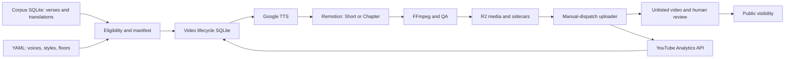

# AI video and YouTube platform

**Reference and explanation · verified against `origin/main` (`4c94bf2`) on 2026-10-12.** This platform turns the reader's Sanskrit corpus and translations into narrated text compositions for [SOHAM HAMSO](https://www.youtube.com/@sohamhamso). Google speech synthesis supplies narration; React/Remotion and FFmpeg produce the pictures and encoded video. The baseline has no text-to-video model integration and uses text, fonts, colors, and transitions rather than AI-generated scene imagery.

For command procedures, use the [operator handbook](../scripts/youtube/README.md); for architectural rationale, see [media lifecycle and recovery](decisions/004-media-lifecycle-recovery.md). This document describes implemented interfaces, including their limitations. Checked-in workflows establish configuration, not successful execution or production availability.

## Capability and rollout boundaries

| Capability | Evidence and status at the baseline |
| --- | --- |
| Single-verse Shorts, 1080×1920 | Merged: [`Short.tsx`](../youtube/composition/Short.tsx), [`render-engine.ts`](../pipeline/youtube/render-engine.ts). English is the default; language selection and Indic fonts exist. |
| Full chapters, 1920×1080 | Merged: [`Chapter.tsx`](../youtube/composition/Chapter.tsx), [`chapter-render-engine.ts`](../pipeline/youtube/chapter-render-engine.ts). Configured `chapters.langs: [en]`. |
| Uploads | Merged uploader; **scheduled upload is paused** in [`youtube-upload.yml`](../.github/workflows/youtube-upload.yml), with manual dispatch enabled. Chapters are additionally held by `chapters.uploads_enabled: false`. |
| Per-language channels and Azure speech | **Branch-only**, commit [`8aa582f`](https://github.com/dannyb66/sohamhamso/commit/8aa582f2ec2477c9ac4f821d13f61e6f5717931d); not part of this baseline. |
| Continuous source audio, timed manifests, parallel Rudri rendering | **Uncommitted local work**, inspected read-only in `.claude/worktrees/rudra-parallel-render` on 2026-10-12; no baseline command or production claim. |
| Public pipeline provenance | No real public video IDs or upload-state export were found in committed baseline data. A public channel alone does not establish which renderer made its videos. |

The historical 149-verse scope covers Śiva Sūtras (77), Spanda Kārikās (52), and Pratyabhijñā Hṛdayam (20). This is a rollout target, not an assertion that 149 translations clear the Shorts review floor or that 149 videos are published. [`youtube-backfill-pending.ts`](../scripts/youtube-backfill-pending.ts) reports actual eligibility and warns when fewer than 149 clear the floor. The corresponding configured English chapter scope is eight combinations: 3 + 4 + 1. VBT and Karpūrādi are explicitly excluded in [`youtube-config.yaml`](../data/youtube-config.yaml) while source permission/license verification is pending. These config flags express project policy; they are not legal adjudications.

## Representative public channel outputs

Observed in the public channel metadata on 2026-10-12:

- [Tripura Rahasya, Chapter 1: English audio and Sanskrit-to-English translation](https://www.youtube.com/watch?v=BpMYhZOb5VE).
- [Shiva Shadakshara Stotram lyric video with English meanings, Sounds of Isha / Trigun Album](https://www.youtube.com/watch?v=fuo18Q8Y9gA).

These illustrate the channel's scripture and devotional outputs. Neither has a verified connection to the current Remotion/TTS lifecycle in committed repository metadata. The second video's credited music requires its own rights and attribution review; its presence on the channel does not authorize corpus/pipeline reuse.

## Boundaries and execution flow



Corpus data is read through [`src/lib/db.ts`](../src/lib/db.ts). Video lifecycle records, quotas, events, and analytics use [`src/lib/videos-db.ts`](../src/lib/videos-db.ts), a separate writable Bun SQLite connection. In Actions, `YOUTUBE_DB_PATH=db/youtube-state.db` selects the lifecycle database, which is pulled from and pushed to R2 at `state/youtube-state.db` by [`youtube-state-db.sh`](../scripts/youtube-state-db.sh). No remote database queue is involved. Without that override the local video API falls back to the corpus database, so isolated exercises must set it explicitly.

All participating workflows use `concurrency.group: youtube-pipeline` and `cancel-in-progress: false`. This serializes their read/modify/upload of one SQLite file. The object-store transfer is last-writer-wins, not a transactional shared database or distributed queue. A local production-state push bypasses workflow serialization and can overwrite intervening runs. A failed pull is treated as first-run absence by the sync shell script; inspect the underlying AWS error before accepting a newly seeded database after an authentication or network failure.

## Corpus grounding and manifests

Short backfill resolves one translation row for each verse/language and checks the text's `min_translation_status` (configured `reviewed`). Its query orders by `ai_assisted ASC, status ASC, created_at ASC`; it does not implement the explicit status-ranking selector used by chapters. Missing or below-floor rows are skipped. An automatic media QA pass is independent of translation review.

Chapter resolution selects `published`, then `reviewed`, then `draft`, breaking ties by row ID, and requires a nonempty translation for every verse. The chapter floor is separately configured as `draft`. This intentionally permits complete preview chapters using draft translations; it does not promote those translations to human-reviewed corpus status. Missing verses make backfill report an incomplete chapter rather than silently omit content.

[`determinism.ts`](../pipeline/youtube/determinism.ts) defines the chapter input manifest:

```json
[
  {
    "verse_num": 1,
    "devanagari": "चैतन्यमात्मा",
    "iast": "caitanyam ātmā",
    "translation_text": "Consciousness is the Self.",
    "translation_row_id": 412,
    "tts_voice_id": "en-US-Studio-O"
  }
]
```

The row ID above illustrates the shape and is not a stable corpus identifier. The chapter hash is MD5 of the ordered JSON manifest. A verse edit, row swap, Sanskrit/IAST change, voice change, or ordering change alters it. A Short's `translation_md5` hashes translation text alone. `template_version` is tracked independently for each format in [`versions.ts`](../pipeline/youtube/versions.ts). These hashes select versions; SHA-256 separately records output bytes. MD5 is not used as a security signature.

`shouldSkipRender` skips matching content/template versions in `rendered`, `approved`, or `uploaded` state. Otherwise backfill supersedes the previous row and inserts a pending version. Chapter rows use `format='chapter'`, `verse_num=0`, and the first verse's translation row as their table-level anchor. Full per-verse translation references live in the generated sidecar. A chapter renderer checks the live manifest again before synthesizing; a changed hash marks the old row `superseded` and returns a skip. A subsequent backfill must create the replacement.

## Speech, text, fonts, and timing

Baseline [`tts-request.ts`](../pipeline/youtube/tts-request.ts) sends plain text to Google `synthesizeSpeech`, requests MP3, and supplies a language code and configured voice. It has no SSML phoneme controls. English uses `en-US-Studio-O`; nine Indic voices are also configured (Hindi, Tamil, Telugu, Kannada, Malayalam, Bengali, Marathi, Gujarati, Punjabi). Configured voice names are not evidence of current provider availability or production narration in every language. Sanskrit is displayed in Devanāgarī/IAST; the implemented baseline narrates the **translation**.

Shorts pass `defaults.speaking_rate: 0.75`; chapters omit the rate and use the provider default. Actual narration duration is probed rather than assumed. Audio file headers determine the data URL's MIME type, even when a path's extension is `.wav` but the payload is MP3. [`audioFileToDataUrl`](../pipeline/youtube/render-engine.ts) makes per-render narration available to Chromium without copying it into `public/` or relying on unsupported local `file:` fetches.

[`fonts.ts`](../youtube/composition/fonts.ts) loads checked-in variable WOFF2 fonts through Remotion's font loader: EB Garamond for Latin/IAST, Noto Serif Devanagari for Sanskrit and several translations, plus Tamil, Telugu, Kannada, Malayalam, Bengali, Gujarati, Gurmukhi, and Oriya faces. [`types.ts`](../youtube/composition/types.ts) maps translation languages to script fonts. Loading before frames render prevents missing glyphs and fallback-font layout drift. Automated frame and props tests complement visual checking; fitting every future verse/script is not guaranteed.

Short timing in [`remotion-props.ts`](../pipeline/youtube/remotion-props.ts) is `1.5s lead-in + measured narration + 1.8s tail`, clamped to 8–180 seconds, rounded into frames. Devanāgarī, IAST, and translation fade in sequentially; narration starts with the translation. The 180-second cap can truncate overlong narration, so inspect long inputs rather than assuming every translation is safe.

Chapter timing in [`chapter-props.ts`](../pipeline/youtube/chapter-props.ts) rounds each span before summing integer frames. The title card lasts at least 5 seconds or title narration plus 1 second; each verse lasts at least 10 seconds or `1.2s lead-in + narration + 1.0s tail`; the outro lasts 9 seconds. When the 10-second floor adds padding, 60% stretches the pre-narration entrance and 40% extends the tail. The sidecar stores absolute segment starts, making the same timing map the source for YouTube timestamps. The visual crossfade does not subtract time from that map.

These are burned-in verse/translation compositions. Baseline upload code does not publish subtitle tracks through a captions API or produce a standard subtitle-file contract. Timed ASS samples belong to the uncommitted external-audio work described below.

## Rendering, quality, and artifact storage

The real engine bundles [`entry.ts`](../youtube/composition/entry.ts), selects `Short` or `Chapter`, renders H.264 through Remotion, and performs final encoding with `ffmpeg-static`. Shorts use controlled 8 Mbps CBR, AAC 192 kbps, `yuv420p`, and `+faststart`; chapters select `cbr8` or `crf18` from config. CBR preserves a deliberately substantial source bitrate for static text but increases storage and upload cost. CRF can shrink simple compositions. There is no measured cost/latency claim in this documentation.

[`probeMp4`](../pipeline/youtube/render-engine.ts) reads duration/codecs and integrated LUFS from an FFmpeg loudness-analysis pass; FFprobe is not bundled. [`qa.ts`](../pipeline/youtube/qa.ts) applies these exact contracts:

| Gate | Shorts | Chapters |
| --- | --- | --- |
| File size | Strictly greater than 100,000 bytes | Strictly greater than 5,000,000 bytes |
| Duration | 6–182 seconds | Finite expected duration; measured difference ≤2 seconds |
| Integrated loudness | Greater than −40 LUFS | Greater than −40 LUFS |
| Codecs | H.264 video, AAC audio | H.264 video, AAC audio |
| ETag comparison | Configured, but compares local MD5 to itself | Disabled |

The Short engine uploads bytes to R2 **before** evaluating its QA result. Failure records may therefore retain an R2 key. Chapters evaluate QA first, then write MP4 followed by JSON sidecar, and approve only when both puts succeed. This is an application-level approval guarantee, not an atomic object-store transaction: an MP4 may remain after a failed sidecar put. Rerunning puts both under the same keys.

The renderers do not fetch a remote R2 ETag. The Short ETag check is therefore ineffective as remote integrity verification. The uploader provides a real check by hashing the **downloaded R2 file** against the recorded output SHA-256 before insertion. It does not hash YouTube's transcoded remote asset.

The implemented storage contract is:

```text
state/youtube-state.db
videos/<text>/<chapter>/<verse>/<lang>/<translation-md5>.mp4
chapters/<text>/<chapter>/<lang>/<manifest-md5>.mp4
chapters/<text>/<chapter>/<lang>/<manifest-md5>.meta.json
```

Chapter sidecar shape (`ChapterSidecar` in the engine):

```json
{
  "segments": [{ "verse_num": 1, "startS": 5, "durationS": 14.2,
                 "translation_row_id": 412, "translation_md5": "example-hash" }],
  "durationS": 28.2,
  "verseCount": 1,
  "lang": "en",
  "voiceId": "en-US-Studio-O",
  "templateVersion": "c1",
  "manifestMd5": "example-manifest-hash",
  "outroStartS": 19.2
}
```

The sidecar persists per-verse references/hashes and timing, not the full Sanskrit/translation text manifest. R2 paths omit template version: a template-only rerender with identical input hash can overwrite the same object path. They are content-addressed naming conventions, not absolute immutability guarantees. Thumbnail/meta/index paths listed in the historical plan are not all written by the current Short engine.

## Lifecycle, retries, and recovery

The schema accepts `pending`, `rendering`, `rendered`, `approved`, `rejected`, `uploading`, `uploaded`, `failed`, and `superseded`. Render pickup stamps a rendering lease; upload pickup stamps an uploading lease. Success progresses to automatic approval and then unlisted upload. These values and helper functions express workflow behavior; the database status CHECK does not enforce every transition edge.

Render attempts stop at three retries. Chapter queue selection excludes failed rows with `last_error_phase='upload'`, preserving a costly rendered artifact after upload trouble. Title/verse TTS has two attempts with verse-specific error messages. [`youtube-lease-sweep.ts`](../scripts/youtube-lease-sweep.ts) treats missing/invalid leases as stale and moves expired rendering/uploading rows to `failed`, recording the original phase. TTL is one hour for Shorts and four hours for chapters. There is no continuously renewed heartbeat; very long jobs need operator attention to these limits.

[`youtube-revisit.ts`](../scripts/youtube-revisit.ts) can reset both retry counters: an upload-phase failure returns to `approved`, other failures return to `pending`. Use this only after resolving the cause. The uploader selects `approved` rows only; ordinary upload failures and expired upload leases require explicit reset rather than automatic pickup by Cron B. Chapter exhaustion exits nonzero so the workflow failure-notification step runs. `--keep-workdir` retains props/audio/intermediate files for diagnosis, which may contain translated content and should remain local.

Supersession creates a new lifecycle version rather than deleting an existing public video. [`youtube-supersede-sweep.ts`](../scripts/youtube-supersede-sweep.ts) can set a superseded video private after 30 days. It does **not** verify that a replacement is public before doing so, and no dedicated scheduled supersede-sweep workflow exists in this baseline. Treat that command as an explicit visibility mutation.

## Upload and human publishing

[`youtube-upload.ts`](../scripts/youtube-upload.ts) takes approved rows with no video ID, skips held chapters, downloads the artifact, validates its stored hash, and requires the chapter timestamp sidecar before `videos.insert`. It builds metadata with canonical reader links and UTM attribution in [`upload-metadata.ts`](../pipeline/youtube/upload-metadata.ts), then stores the returned ID/URL and unlisted visibility. Public publishing is a separate `videos.update` through revisit, after review in Studio.

The uploader accounts for 100 units per successful insert in its local quota table, checks an 8,000-unit ceiling, defaults to two uploads per run, and caps recorded daily uploads at `YT_MAX_UPLOADS_PER_DAY` (default 12). These are code configuration/accounting values, not a guarantee of the provider's quota or account eligibility. Quota/daily-upload-limit errors return rows to approval and stop the batch; expired refresh tokens produce a named reauthorization error; long-upload verification errors fail without burning render retries. The broad 403 quota classifier means operators must inspect the actual error for scope/permission trouble.

Chapter network failures get one retry using a fresh file stream. The request is multipart, not a resumable upload. A response lost after YouTube accepts a file can produce a duplicate; the local DB update cannot make external insertion exactly-once. Inspect Studio before replaying ambiguous failures.

## Analytics and operational visibility

[`youtube-analytics-sync.ts`](../scripts/youtube-analytics-sync.ts) queries YouTube Analytics for uploaded IDs, using at most 50 IDs per filter. [`analytics-map.ts`](../pipeline/youtube/analytics-map.ts) maps views, average view duration, average view percentage, and subscribers gained into lifecycle analytics rows. `watch_time_s` stores **mean seconds watched per view**, not total channel watch time; `completion_rate` is a 0–1 fraction. CTR, Shorts 3-second retention, 50% retention, UTM clicks, and audio language remain NULL when not measured. NULL means unavailable, not zero. Studio metrics and site-side click attribution require separate evidence before evaluating historical rollout thresholds.

[`youtube-status.ts`](../scripts/youtube-status.ts) reports status/retry/error/quota counts and per-format summaries. Pipeline-run records include phases and durations; logs use [`log.ts`](../pipeline/youtube/log.ts) redaction. Failure workflows create GitHub issues; the digest can use an optional Slack webhook. Those workflow side effects are not part of the credential-free exercise.

| Workflow | Configured UTC schedule on 2026-10-12 |
| --- | --- |
| Generate Shorts | `23 */6 * * *` |
| Generate chapters | `0 3,15 * * *` |
| Upload | **Paused schedule**, manual dispatch only |
| Analytics | `0 5 * * *` |
| Digest | `13 11 * * *` |
| Lease sweep | `27 * * * *` |

## Configuration and credentials reference

[`config.ts`](../pipeline/youtube/config.ts) validates YAML with Zod and checks text/style/voice relationships and forbidden palette choices. Config controls eligible text slugs, per-format translation floors, voices, presets, frame rates, speaking rate, chapter timing/encoding, and chapter upload hold. Palette choices encode the project's editorial style; they do not establish a source's licensing status.

| Setting | Purpose |
| --- | --- |
| `SOHAMHAMSO_DB_PATH` | Optional corpus DB override |
| `YOUTUBE_DB_PATH` | Lifecycle state DB; set explicitly for exercises |
| `GOOGLE_TTS_CREDENTIALS_JSON` | Inline service-account credentials explicitly passed to the Google client |
| `GOOGLE_APPLICATION_CREDENTIALS` | Local Google application-default credential file path |
| `GOOGLE_TTS_API_KEY` | Recognized by the secret resolver, but not explicitly passed into the baseline client constructor; do not rely on API-key-only setup |
| `YOUTUBE_OAUTH_CLIENT_ID`, `YOUTUBE_OAUTH_CLIENT_SECRET`, `YT_REFRESH_TOKEN` | Single baseline channel authorization |
| `R2_BUCKET` | Bucket, default `sohamhamso-backups` |
| `AWS_ACCESS_KEY_ID`, `AWS_SECRET_ACCESS_KEY`, `AWS_ENDPOINT_URL` | S3-compatible R2 access |
| `MOCK_ALL=true` | Replaces external integration calls; local files/DB can still change |
| `YT_MAX_UPLOADS_PER_DAY` | Local daily count guard, default 12 |

[`secrets.ts`](../pipeline/youtube/secrets.ts) centralizes lookup and fails fast for missing production/CI credentials unless mock mode is enabled. OAuth setup requests the union of `youtube.upload`, `yt-analytics.readonly`, and `youtube.force-ssl`; the latter authorizes video metadata/visibility updates. Scope comments elsewhere saying upload-only are historical. Whether the actual OAuth app remains in Testing mode must be checked in the operator's console; old dated token rotations are not current credentials evidence.

## How to inspect without external side effects

After the root onboarding (`bun install`, `bun run db:ensure`), validate config and preview manifests. Set `YOUTUBE_DB_PATH` to a disposable copy before running video commands, because some dry-run commands still open a writable SQLite handle.

```bash
bun run youtube:validate-config
video_example_dir="$(mktemp -d -t sohamhamso-video-state)"
export YOUTUBE_DB_PATH="$video_example_dir/youtube-state.db"
cp db/sohamhamso.db "$YOUTUBE_DB_PATH"
bun scripts/youtube-backfill-pending.ts --dry-run --json --limit=2
bun scripts/youtube-backfill-chapters.ts --dry-run --json --text-slug=spanda-karikas --chapter=2
bun scripts/youtube-render-chapter-samples.ts --dry-run --json --text-slug=siva-sutras --chapter=1 --limit=1
```

Expected results are eligibility/action JSON and a sample plan, without TTS, R2, YouTube upload, email, or deployment. A disposable copy also supplies the current schema. Remove the disposable directory after inspection. The Short preview reports `totalInserted` as its would-insert count even in dry-run mode; `dryRun: true` establishes that no rows were inserted. With `--limit=2`, its below-149 warning reflects the cap, not corpus-wide review coverage.

For a real local visual sample with silent audio:

```bash
MOCK_ALL=true bun scripts/youtube-render-chapter-samples.ts \
  --text-slug=siva-sutras --chapter=1 --limit=1 --out=samples-chapters-doc-preview
```

The `--out` value is treated as a path joined beneath the repository working directory; use a relative directory. This sample tool genuinely runs Remotion/Chromium and writes a real MP4/timing JSON. It needs installed rendering dependencies and may download Chromium on first use; it does not write R2 or lifecycle state. Silent sample output fails a real loudness gate and is not production approved.

In contrast, `MOCK_ALL=true` inside the production render engines writes padded canned WAV bytes under an MP4 filename and supplies assumed duration/loudness/codec metrics. It tests orchestration, hashes, and state changes, not decoding, typography, speech quality, or real media QA. A mock uploader creates synthetic IDs, not public videos.

Run integration tests through the supplied isolation wrapper:

```bash
bun run youtube:test
bun run youtube:integration
```

The wrapper starts a fresh Vitest process per test file because Bun SQLite module state can leak across files. Relevant evidence includes [chapter timing](../tests/unit/youtube/chapter-timing.test.ts), [chapter determinism](../tests/unit/youtube/chapter-determinism.test.ts), [queue failure phases](../tests/unit/youtube/render-queue-chapters.test.ts), [QA](../tests/unit/youtube/qa-chapter.test.ts), [lease recovery](../tests/unit/youtube/lease-sweep.test.ts), [metadata](../tests/unit/youtube/chapter-upload-metadata.test.ts), [redaction](../tests/unit/youtube/pipeline-run-redaction.test.ts), and [analytics](../tests/unit/youtube/analytics-sync.test.ts). These tests establish tested contracts, not live provider availability.

## Aligned alternate audio and external source audio

The **merged** `--audio-only` chapter mode rebuilds translations for a target language and places their narration into the rendered video's sidecar slots at 48 kHz mono PCM. Title/outro are silent. A missing sidecar or non-chapter row is a configuration error; verse-count mismatch requires rerendering. Longer narration is hard-truncated to the slot and logged, so listening is mandatory before manually adding a track in Studio. This path produces audio only, does not mutate DB/R2, and incurs TTS calls outside mock mode. It does not establish current YouTube multi-audio eligibility or an automated captions/dubbing API.

The **uncommitted** Rudri worktree adds `external-audio-chapter.ts`, `youtube-render-external-audio.ts`, `youtube-verify-external-audio.ts`, `parallel-render.ts`, `parallel-render-worker.ts`, and `youtube-render-parallel.ts`. Its local manifest contains a continuous audio path plus per-verse Sanskrit/translation and explicit `startS`/`endS`; `audioRightsCleared: true` is an operator attestation required before mapping props. Validation checks finite increasing nonoverlapping times and audio length. That attestation does not independently verify rights.

The local parallel design partitions verse intervals, fingerprints manifest/audio/background/renderer/style/validator inputs, records pending/rendering/verified/failed jobs, and uses persisted state for retries/resume before final composition. ASS proof samples and several background PNGs exist locally. File names alone establish neither AI-image provenance nor source-audio rights. These are evidence of ongoing experimentation, not merged source references, measured speed improvements, or a public Rudri release. Once merged, replace this dated local-evidence description with commit links and verified commands.

## Parallel Rudri source extraction (uncommitted)

A separate implementation in the primary local worktree adds `pipeline/rudri/`, `scripts/rudri-generate-manifest.ts`, `scripts/rudri-render-parallel.ts`, and a local `docs/RUDRI-PARALLEL-PIPELINE.md` runbook. These files are not in this documentation baseline. Their inputs are a rights-attested recording and optional reviewed seed manifest. Outputs include source/audio hashes, per-window ASR/OCR records, alignment decisions, a reviewed timing/translation manifest, ASS subtitles, per-verse parts and final probe reports under `work/<source-sha256>/`.

Manifest generation uses 90-second windows with 5 seconds of overlap, bounded concurrency, Whisper `medium` with `sa`, Tesseract Devanagari OCR and FFmpeg silence hints. It persists `manifest/jobs.json` after each window; resumed work checks the source hash and reuses completed artifacts. ASR/OCR disagreements, missing IAST/translation and absent audio clearance keep the manifest review-gated. Applying reviewed seed timing approves only its specified verses, not the remaining source. The cutoff can extend to the end of the first complete verse.

Rendering writes ASS/audio/video parts per verse, probes before an atomic local rename, concatenates video parts in order, then muxes the continuous source audio once. The final output passes the local external-audio verifier. A local study override produces a distinct draft manifest and report rather than silently modifying the reviewed source. These are implementation observations, not proof of a deployed Rudri pipeline, accurate ASR/OCR, rights clearance, or measured parallel speedup. The [evolution document](EVOLUTION-FROM-PROTOTYPE.md) and [capability matrix](CAPABILITY-MATRIX.md) preserve the distinction from the merged Google TTS/Remotion workflow.

## Known limits and next verification

The current system has recoverable persisted workflow state but no distributed worker queue, upload idempotency key, renewed leases, remote R2 ETag validation, or reliable exactly-once external publishing. Short input hashing omits voice changes; R2 keys omit template version. Media QA measures containers/codecs/loudness/duration, not translation truth, cultural appropriateness, clipping, pronunciation, or every visual overflow. Human review remains responsible for those judgments and for source/audio/visual attribution.

To establish a public output's provenance, retain its YouTube ID alongside lifecycle row, input hash, template version, source/translation references, and rendered artifact checksum. Verify that the public video matches that record and record the observation date. Channel screenshots, historical subscriber counts, and pipeline capability alone cannot substitute for that evidence.
