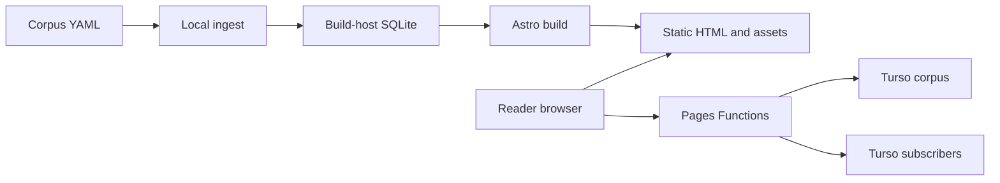

# Web delivery and edge

Explanation and reference. Evidence baseline: `origin/main` at `4c94bf2`, inspected 2026-10-12. Configuration describes intended delivery; it does not prove which revision is running in production. See the [documentation index](README.md) for the dated capability inventory.

## Rendering boundaries

[astro.config.mjs](../astro.config.mjs) uses Astro 5, `output: 'static'`, the Cloudflare adapter, Solid integration, and Tailwind's Vite plugin. Static output still permits individual routes to export `prerender = false`. Calling the application wholly static would obscure its database-dependent reader pages.

| Surface | Execution | Inputs and outputs |
| --- | --- | --- |
| Home, tradition/text/chapter indexes, locale pages, lemma pages, daily page | Build-time HTML | Local corpus SQLite, corpus SEO metadata, dictionaries → files in `dist/` |
| Both verse route families | Request-time SSR | URL parameters + corpus backend → verse HTML, all-language reader payload, SEO metadata |
| `/search` and `/api/search` | Request-time SSR/API | Query parameters → results HTML or JSON |
| `/api/subscribe`, `/api/confirm`, `/api/unsubscribe`, confirmation landings | Request time | Form/query token → subscriber database operations and redirects |
| `/og/...` and `/og/lemma/...` | Request-time image endpoints | Corpus/SEO payload + bundled fonts → social-card image |
| Sitemaps and robots | Build-time endpoints | Corpus route catalogue and indexing policy → XML/text |

The two reader implementations are [the English route](../src/pages/[tradition]/[text]/[chapter]/[verse].astro) and [the locale route](../src/pages/[lang]/[tradition]/[text]/[chapter]/[verse].astro). They validate reference parameters, call [readVersePage](../src/lib/verse-read.ts), resolve tradition/slug aliases before rendering, and return 301 for valid aliases, 404 for absent references, or styled 503 with `Retry-After: 30` for a corpus backend failure. A rendered 503 is materially different from an empty translation or a missing verse.

The deployment-file budget motivated moving verses to SSR: multiplying every reference by 12 locales would approach Cloudflare Pages' documented-in-code 20,000-file gate. [check-dist-filecount.ts](../scripts/check-dist-filecount.ts) is the repository's enforceable budget, rather than a count inferred from the number of texts. See [decision 001](decisions/001-static-versus-ssr.md).

## URL locale and reader preference

The configured locales are `en`, `hi`, `ta`, `te`, `bn`, `mr`, `gu`, `kn`, `ml`, `pa`, `or`, and `as`; English has no required prefix. Example canonical routes are `/trika/siva-sutras/1/1` and `/hi/trika/siva-sutras/1/1`. A locale route determines initial server-rendered language, canonical URL, hreflang, and indexing eligibility. It does not establish that every verse has a published translation in that language.

[BaseLayout](../src/layouts/BaseLayout.astro) supplies canonical metadata and mounts `SettingsSheet`, `SearchBox`, `I18nSwap`, and `ReaderLangSwap` with `client:idle`. The HTML arrives before islands hydrate. [I18n helpers](../src/i18n/index.ts) load a selected dictionary lazily and fall back to English, then to the key string when neither dictionary has an entry. [ReaderLangSwap](../src/components/ReaderLangSwap.solid.tsx) uses the page's `window.__readerData` to update translation and gloss content after preference changes; it safely does nothing on pages without that payload. URL locale and saved browser preference should therefore be tested separately.

[reading-modes.ts](../src/lib/reading-modes.ts) is the shared language/script registry. Transliteration changes the displayed Sanskrit script; it is distinct from changing translation language. Fonts are self-hosted under [public/fonts](../public/fonts), with [font asset mapping](../src/lib/font-assets.ts) and [font CSS](../src/styles/fonts.css) selecting the Latin and Indic faces. Combining marks and script-specific coverage need browser verification, not just successful TypeScript compilation.

## Caching and invalidation

| Response | Implemented header or cache |
| --- | --- |
| Successful verse SSR | `public, max-age=300, s-maxage=86400, stale-while-revalidate=604800` |
| Verse 404 | `public, max-age=300` |
| Verse backend unavailable | `no-store`, `Retry-After: 30` |
| Successful search API | `public, max-age=10, s-maxage=30` |
| Search error | `no-store` |
| Confirm/unsubscribe redirects | `no-store, max-age=0` |
| Semantic query embeddings | Process-local LRU, maximum 1,000 entries, 7-day TTL |

Headers express browser/shared-cache policy. The verse source explicitly notes that Pages Function responses are **not automatically cached by Cloudflare's CDN**; the baseline does not establish a Cache API layer or configured cache rules. A worker instance's module-level database client and LRU are neither durable storage nor a distributed cache. Cloudflare KV mentioned in search comments is a future design, not the implemented embedding cache.

If a shared edge cache is added, corpus updates require explicit invalidation: remote corpus seeding can alter data independently of a Pages deployment. The current cache TTL permits stale client/intermediary content; a deployment alone is not proof of a purge.

## Runtime and search contracts

[db.ts](../src/lib/db.ts) exposes synchronous Bun SQLite helpers for build-host reads. Its current implementation has a type-only `bun:sqlite` import and loads the constructor with guarded top-level-await dynamic import; older corpus adapter comments describing a static driver import are historical. [corpus-db.ts](../src/lib/corpus-db.ts) exposes async `all`, `get`, and optional `batch`; Bun delegates to local SQLite, whereas the edge uses `@libsql/client/web` and `TURSO_CORPUS_URL`/`TURSO_CORPUS_AUTH_TOKEN`. [subscriber-db.ts](../src/lib/subscriber-db.ts) isolates writable subscriber operations with the corresponding PII variables. Runtime-guarded dynamic imports prevent an edge request from evaluating Bun's native SQLite module.

`readVersePage` batches multiple SELECTs into one libSQL read exchange where supported; injected test backends without `batch` use sequential calls. This optimizes database round trips while keeping driver details out of the route. It is not a measured latency guarantee.

[GET /api/search](../src/pages/api/search.ts) accepts required trimmed `q` up to 500 characters, `type` (`lexical`, `semantic`, `blended`), `lang` (default `en`), and `limit` (default 8, bounded at 50). Unknown types fall back to lexical; invalid limits fall back to 8. The response is `{ data: VerseHit[], meta: { count, type, took_ms, note? } }`. A missing search module/function may return an empty result with a note; a backend error returns 500 with a generic public error. Read `meta.note` when diagnosing an empty result.

Lexical search can run without model credentials. Semantic query embedding may call OpenAI and incur API charges; it needs the configured embedding key and compatible stored vectors. [search.ts](../src/lib/search.ts) owns lexical/semantic/blended behavior and fallback details. Zero-result [search-miss logging](../src/lib/search-miss.ts) writes sanitized demand records through the corpus backend; consequently this backend is read-mostly, not an enforced read-only database boundary.

## Verification and deployment variants

The baseline supports Bun development/build and Cloudflare output. [verse SSR e2e tests](../tests/e2e/verse-ssr.spec.ts), [reader language tests](../tests/e2e/reader-lang-swap.spec.ts), [edge compatibility regression](../tests/unit/search-edge-compat.regression-1.test.ts), and [SEO locale route tests](../tests/unit/seo/i18n-routes.test.ts) exercise distinct parts of that contract. Playwright uses Chromium for both desktop and iPhone viewport projects; this does not establish Safari/WebKit compatibility.

Uncommitted files inspected in the original working directory on 2026-10-12 propose static corpus JSON assets, D1 subscriber bindings, explicit Node target selection, and Docker packaging. The Dockerfile builds a Node adapter target but runs it using a Bun container. Those files are absent from this selected baseline; do not run their commands against this worktree or call them merged/deployed features. Their local cutover document's production language is an assertion requiring separate deployment evidence. Baseline operating instructions remain in [Operations](OPERATIONS-AND-QUALITY.md) and [Turso](TURSO.md).
