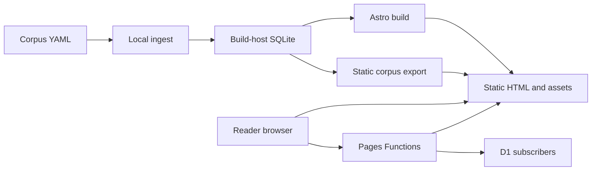

# Web delivery and edge

> Website runtime update (2026-10-25): public reading, search, and preview images use generated static corpus assets; subscriber endpoints use Cloudflare D1. Turso is retired from website requests. Older topology descriptions below are historical. Follow [the current cutover runbook](D1-CUTOVER.md) and the README no-Turso policy.

Explanation and reference, updated for the 2026-10-25 static corpus release. The broader inventory was inspected at `4c94bf2` on 2026-10-12. Configuration describes delivery behavior; it does not prove which revision is running in production. Follow [the cutover runbook](D1-CUTOVER.md) for current deployment checks.

## Rendering boundaries

[astro.config.mjs](../astro.config.mjs) uses Astro 5, `output: 'static'`, the Cloudflare adapter, Solid integration, and Tailwind's Vite plugin. Static output still permits individual routes to export `prerender = false`. Corpus content is generated at build time; verse HTML is assembled on request from those static files.

| Surface | Execution | Inputs and outputs |
| --- | --- | --- |
| Home, tradition/text/chapter indexes, locale pages, lemma pages, daily page | Build-time HTML | Local corpus SQLite, corpus SEO metadata, dictionaries → files in `dist/` |
| Both verse route families | Request-time SSR | URL parameters + static chapter/lemma JSON → verse HTML, all-language reader payload, SEO metadata |
| `/search` and `/api/search` | Request-time SSR/API | Query parameters + static language index → results HTML or JSON |
| `/api/subscribe`, `/api/confirm`, `/api/unsubscribe` | Request time | Form/query token → D1 subscriber operations, confirmation mail and redirects |
| Confirmation/unsubscribe landing pages | Build-time HTML | Static confirmation/error messages |
| `/og/...` and `/og/lemma/...` | Request-time image endpoints | Static corpus/lemma payload + bundled fonts → social-card image |
| Sitemaps and robots | Build-time endpoints | Corpus route catalogue and indexing policy → XML/text |

The two reader implementations are [the English route](../src/pages/[tradition]/[text]/[chapter]/[verse].astro) and [the locale route](../src/pages/[lang]/[tradition]/[text]/[chapter]/[verse].astro). They validate reference parameters, call [readStaticVersePage](../src/lib/static-corpus-read.ts), resolve tradition/slug aliases before rendering, and return 301 for valid aliases, 404 for absent references, or styled 503 with `Retry-After: 30` for unavailable corpus assets. A rendered 503 is materially different from an empty translation or a missing verse.

The deployment-file budget motivated moving verses to SSR: multiplying every reference by 12 locales would approach Cloudflare Pages' documented-in-code 20,000-file gate. [check-dist-filecount.ts](../scripts/check-dist-filecount.ts) is the repository's enforceable budget, rather than a count inferred from the number of texts. See [decision 001](decisions/001-static-versus-ssr.md).

## URL locale and reader preference

The configured locales are `en`, `hi`, `ta`, `te`, `bn`, `mr`, `gu`, `kn`, `ml`, `pa`, `or`, and `as`; English has no required prefix. Example canonical routes are `/trika/siva-sutras/1/1` and `/hi/trika/siva-sutras/1/1`. A locale route determines initial server-rendered language, canonical URL, hreflang, and indexing eligibility. It does not establish that every verse has a published translation in that language.

[BaseLayout](../src/layouts/BaseLayout.astro) supplies canonical metadata and mounts `SettingsSheet`, `SearchBox`, `I18nSwap`, and `ReaderLangSwap` with `client:idle`. The HTML arrives before islands hydrate. [I18n helpers](../src/i18n/index.ts) load a selected dictionary lazily and fall back to English, then to the key string when neither dictionary has an entry. [ReaderLangSwap](../src/components/ReaderLangSwap.solid.tsx) uses the page's `window.__readerData` to update translation and gloss content after preference changes; it safely does nothing on pages without that payload. URL locale and saved browser preference should therefore be tested separately.

[reading-modes.ts](../src/lib/reading-modes.ts) is the shared language/script registry. Transliteration changes the displayed Sanskrit script; it is distinct from changing translation language. Fonts are self-hosted under [public/fonts](../public/fonts), with [font asset mapping](../src/lib/font-assets.ts) and [font CSS](../src/styles/fonts.css) selecting the Latin and Indic faces. Combining marks and script-specific coverage need browser verification, not just successful TypeScript compilation.

## Caching and invalidation

| Response | Implemented header or cache |
| --- | --- |
| Successful verse SSR | `public, max-age=300, s-maxage=86400, stale-while-revalidate=604800` |
| Verse 404 | `public, max-age=300` |
| Verse backend unavailable | `no-store`, `Retry-After: 30` |
| Successful search API | `public, max-age=10, s-maxage=3600` |
| Search error | `no-store` |
| Confirm/unsubscribe redirects | `no-store, max-age=0` |
| Static chapter, manifest, lemma and search reads | Process-local cache of successful immutable assets; failed reads may retry |

Headers express browser/shared-cache policy. The verse source explicitly notes that Pages Function responses are **not automatically cached by Cloudflare's CDN**; headers alone do not establish a Cache API layer or configured cache rules. Successful corpus reads are cached within a Worker instance. That cache is neither durable storage nor a distributed cache. OG rendering separately uses the Cache API when available.

Corpus updates require a fresh ingest, export and deployment of the assets together with the Worker. The exporter excludes `/_data/*` from Worker routing so Pages serves these files directly. Current cache TTLs permit stale client/intermediary content; a deployment alone is not proof of a purge.

## Runtime and search contracts

[db.ts](../src/lib/db.ts) exposes synchronous Bun SQLite helpers for build-host reads. Its type-only `bun:sqlite` import and guarded dynamic loading keep native SQLite out of edge execution. [static-corpus-read.ts](../src/lib/static-corpus-read.ts) reads generated manifest, chapter and lemma JSON through `ASSETS` at the edge and local `dist/_data/corpus/` files under Bun. [subscriber-db.ts](../src/lib/subscriber-db.ts) and [subscriber-confirm.ts](../src/lib/subscriber-confirm.ts) use the `PII_DB` D1 binding at the edge and SQLite locally. Legacy libSQL adapters must not be imported by website request handlers.

`bun run dev` ensures a local database exists and exports corpus assets before starting Astro. `bun run build` and `bun run seo:build` export after Astro builds and verify public corpus counts against SQLite. `db:ensure` does not detect changed YAML: run ingestion again after source edits and regenerate assets. No website reader requires a remote database or model API key.

[GET /api/search](../src/pages/api/search.ts) accepts required trimmed `q` up to 500 characters, `type` (`lexical`, `semantic`, `blended`), `lang` (default `en`), and `limit` (default 8, bounded at 50). Unknown types fall back to lexical; invalid limits fall back to 8. The response is `{ data: VerseHit[], meta: { count, type, took_ms, note? } }`. An unavailable language index returns 503 with `no-store`. Successful results report `type: 'lexical'`; `meta.note` identifies static lookup or semantic/blended fallback.

[static-search.ts](../src/lib/static-search.ts) matches Sanskrit, transliteration and full published/reviewed translation text from generated indexes; response excerpts remain bounded. It makes no embedding calls and performs no corpus writes. Historical [search.ts](../src/lib/search.ts) and [search-miss.ts](../src/lib/search-miss.ts) remain operator/experimental code rather than public request dependencies.

## Verification and deployment variants

The baseline supports Bun development/build and Cloudflare output. [verse SSR e2e tests](../tests/e2e/verse-ssr.spec.ts), [reader language tests](../tests/e2e/reader-lang-swap.spec.ts), [edge compatibility regression](../tests/unit/search-edge-compat.regression-1.test.ts), and [SEO locale route tests](../tests/unit/seo/i18n-routes.test.ts) exercise distinct parts of that contract. Playwright uses Chromium for both desktop and iPhone viewport projects; this does not establish Safari/WebKit compatibility.

Static corpus and D1 subscriber code are included in this release. [Static runtime tests](../tests/unit/static-corpus-runtime.test.ts), [health checks](../tests/unit/static-corpus-health.test.ts), and [D1 tests](../tests/unit/subscriber-d1.test.ts) cover the new boundary. Follow [D1-CUTOVER.md](D1-CUTOVER.md) for deployment and live verification. Node/Docker and a separate daily email Worker remain outside this website release. [Turso](TURSO.md) is a historical runbook and must not be used to restore a website dependency.
